  
<h1 align="center">Hey, I'm whateving.</h1>
  

 I build Python tools and investigate how systems fail.  Focused on AI security, detection engineering, and secure backend development. 

  

<h2 align="center">Selected projects</h2>
Permission Goblin — A macOS permission viewer with optional local LLM advice, deterministic checks, and documented model evaluations.
DNSentinel — A DNS analysis workbench with behavioral features, explainable rules, and a local investigation dashboard.
Security Investigations & Projects — Cloud and endpoint investigations, AI security exercises, network configurations, and security automation.
TaskForge — A Python background-job processing system exploring concurrency, retries, recovery, and observability.
I document implementation choices, test results, and limitations alongside the code.

<h2 align="center">Tech stack</h2>
  

<h2 align="center">GitHub stats</h2>
    

<h2 align="center">Watch the contributions disappear</h2>
 <picture> <source media="(prefers-color-scheme: dark)" srcset="https://raw.githubusercontent.com/whateving/whateving/output/github-snake-dark.svg" /> <source media="(prefers-color-scheme: light)" srcset="https://raw.githubusercontent.com/whateving/whateving/output/github-snake.svg" />  </picture> 

 <code>stay curious // build securely // keep it chill</code> 

⋮⋮⋮⋮⋮⋮⋮⋮⋮⋮⋮⋮⋮⋮⋮⋮⋮⋮⋮⋮
